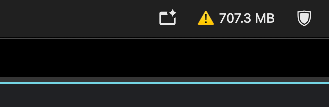

# macOS Memory Warning (`Memory Warning.app`)

[](https://opensource.org/licenses/MIT)
[](https://www.apple.com/macos/)
[](https://developer.apple.com/swift/)

A lightweight, 100% native **macOS Menu Bar (tray) app** that monitors running processes and alerts you with native system notifications whenever any process exceeds a configurable RAM threshold (e.g., `500 MB`, `1 GB`, `2 GB`).



---

## Features

- 🖥️ **100% Native macOS `.app` Bundle (Zero Dependencies)**:
  - Compiled natively with Swift (`AppKit` Universal Binary for both Apple Silicon `arm64` & Intel `x86_64`).
  - No external runtimes required — just open **`Memory Warning.app`**!
  - Sits quietly in the top status bar as `💾` (or `⚠️ 1.4 GB` when high memory is detected) without cluttering the Dock (`LSUIElement = true`).
- 📊 **Live Top 5 Memory Consumers**:
  - Displayed right in the 1st-level dropdown menu and refreshed automatically while the menu is open.
- ⚡ **Interactive Controls**:
  - Change memory threshold (`500MB`, `1GB`, `1.5GB`, `2GB`, `3GB`, `4GB` or custom value).
  - Change check interval (`2s`–`60s`), toggle notifications, and toggle alert sound.
  - Remembers your settings in `~/.config/memory-warning/config.json`.
- 🌐 **Multilingual (EN / RU)**:
  - Automatically adapts to macOS system language, with manual toggle in the menu bar.
- 🔔 **Smart Notifications**:
  - Native Notification Center alerts with cooldown protection against spam (once every 5 minutes per process).

---

## Quick Start

1. Double-click **`Memory Warning.app`** in Finder (or drag it into `/Applications`).
2. Look for the **`💾`** icon in the top-right macOS menu bar.
3. Click **`💾`** to view top memory consumers, adjust thresholds, or quit (**Quit** / **Выход**).

---

## Building from Source

Requires macOS with Xcode Command Line Tools (`swiftc`):

```bash
chmod +x build_app.sh
./build_app.sh
```

This compiles `macos/main.swift` into a Universal Binary (`arm64` + `x86_64`) and generates **`Memory Warning.app`**.

---

## Releasing New Versions

Releases are automatically built and published via GitHub Actions when a version tag is pushed:

```bash
git tag v0.3.0
git push origin v0.3.0
```

GitHub Actions compiles `Memory Warning.app`, packages `Memory-Warning-v0.3.0-macos.zip`, and publishes a GitHub Release.

---

## License

This project is licensed under the [MIT License](LICENSE).
